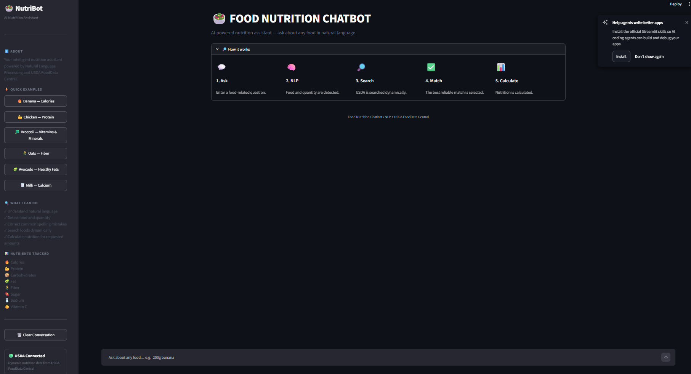
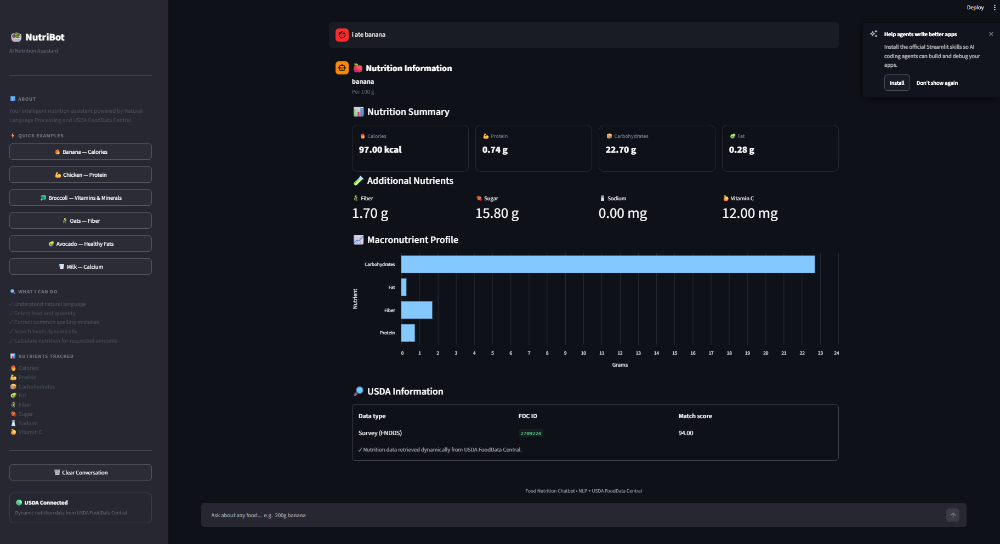
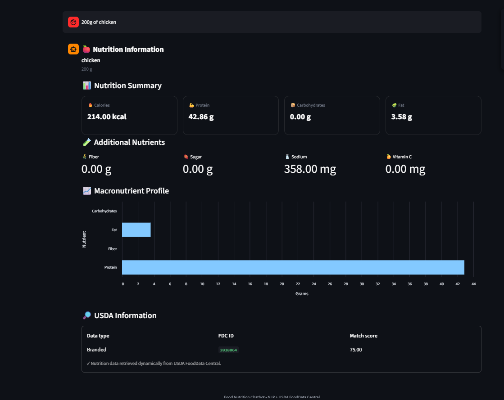

# 🥗 Food Nutrition Chatbot

<div align="center">


<br>


<br><br>

**An NLP-powered nutrition assistant that understands natural-language food queries and dynamically retrieves nutrition information from USDA FoodData Central.**

</div>

---

# 📌 Overview

**Food Nutrition Chatbot** is an intelligent NLP-based application that allows users to ask natural-language questions about food and receive structured nutritional information.

Instead of relying on a small hardcoded food database, the chatbot uses **USDA FoodData Central** as its primary nutrition source. This allows users to enter a wide variety of foods dynamically.

For example:

```text
banana
200g banana
I ate 150 grams of mango
2 apples
chickwn wings
dragon fruit
quinoa
paneer
salmon
```

The system extracts the **food name, quantity, unit, and intent**, retrieves the most relevant food from USDA, calculates nutrition according to the requested quantity, and presents the result through a Streamlit dashboard.

---

# 🎯 Project Objective

The main objective of this project is to build a practical NLP-based nutrition assistant that can:

* 🧠 Understand natural-language food queries
* 🔎 Dynamically retrieve food information
* 🥗 Handle a wide range of food items
* ✏️ Correct common food-name spelling mistakes
* ⚖️ Understand quantities and units
* 🧮 Calculate nutrition for requested quantities
* 📊 Present nutrition information clearly
* 🛡️ Avoid inventing nutrition values for unknown foods
* 🧪 Validate functionality using automated tests

---

# ✨ Key Features

## 🧠 Natural Language Processing

The chatbot understands different ways of asking for nutrition information.

Examples:

```text
banana
200g banana
I ate 150 grams of mango
Give me nutrition for 2 apples
How much protein is in chicken?
```

The NLP layer identifies:

* Food entity
* Quantity
* Unit
* User intent

---

## 🔤 Food Name Correction

The system can handle common food-name typing mistakes.

| User Input | Corrected Food |
| ---------- | -------------- |
| `bananna`  | banana         |
| `banan`    | banana         |
| `brocolli` | broccoli       |
| `chiken`   | chicken        |
| `chikn`    | chicken        |
| `chickwn`  | chicken        |
| `tomatos`  | tomato         |
| `potatos`  | potato         |
| `spinich`  | spinach        |
| `avacado`  | avocado        |

This correction layer improves the user's experience without turning the application into a fixed food database.

---

# 🌎 Dynamic Food Retrieval

One of the most important design decisions in this project is that the chatbot **does not depend on a fixed list of trained food items**.

Instead:

```text
User Food Query
       ↓
NLP Food Extraction
       ↓
USDA FoodData Central Search
       ↓
Candidate Ranking
       ↓
Best Food Match
       ↓
Nutrition Extraction
       ↓
Quantity Calculation
       ↓
Chatbot Response
```

This means users can enter foods that were never explicitly hardcoded into the application.

Examples include:

* 🥭 Mango
* 🍎 Apple
* 🍌 Banana
* 🐉 Dragon fruit
* ❤️ Pomegranate
* 🌾 Quinoa
* 🐟 Salmon
* 🧀 Paneer
* 🌱 Tofu
* 🥝 Kiwi
* 🍈 Cantaloupe
* 🌿 Asparagus
* 🍗 Chicken
* 🌰 Almonds
* 🌱 Lentils
* 🥔 Sweet potato
* 🌳 Jackfruit

The application retrieves available nutrition information dynamically from USDA FoodData Central.

---

# 🏛️ System Architecture

```text
                    ┌──────────────────────┐
                    │        USER          │
                    │ Natural Language     │
                    │       Query          │
                    └──────────┬───────────┘
                               │
                               ▼
                    ┌──────────────────────┐
                    │    NLP PROCESSOR     │
                    │                      │
                    │ • Intent Detection   │
                    │ • Food Extraction    │
                    │ • Quantity Extraction│
                    │ • Unit Detection     │
                    │ • Spell Correction   │
                    └──────────┬───────────┘
                               │
                               ▼
                    ┌──────────────────────┐
                    │   FOOD RETRIEVAL     │
                    │                      │
                    │ USDA FoodData        │
                    │ Central API          │
                    └──────────┬───────────┘
                               │
                               ▼
                    ┌──────────────────────┐
                    │  MATCHING & RANKING  │
                    │                      │
                    │ • Exact matching     │
                    │ • Generic food       │
                    │ • Prepared food      │
                    │ • Food variants      │
                    │ • Match scoring      │
                    └──────────┬───────────┘
                               │
                               ▼
                    ┌──────────────────────┐
                    │ NUTRITION EXTRACTION │
                    │                      │
                    │ Calories             │
                    │ Protein              │
                    │ Carbohydrates        │
                    │ Fat                  │
                    │ Fiber                │
                    │ Sugar                │
                    │ Minerals & Vitamins  │
                    └──────────┬───────────┘
                               │
                               ▼
                    ┌──────────────────────┐
                    │ QUANTITY CALCULATION │
                    │                      │
                    │ grams / kg / mg      │
                    │ serving / piece      │
                    └──────────┬───────────┘
                               │
                               ▼
                    ┌──────────────────────┐
                    │    STREAMLIT UI      │
                    │                      │
                    │ Nutrition Dashboard  │
                    │ Charts & Results     │
                    └──────────────────────┘
```

---

# 🔄 NLP Processing Pipeline

The chatbot processes every query through several stages.

### 1️⃣ Input

```text
"I ate 200g banana"
```

### 2️⃣ Text Normalization

The input is cleaned and normalized.

### 3️⃣ Spelling Correction

Common food-name errors are corrected.

Example:

```text
chickwn → chicken
```

### 4️⃣ Food Extraction

```text
banana
```

### 5️⃣ Quantity Extraction

```text
200
```

### 6️⃣ Unit Detection

```text
g
```

### 7️⃣ Intent Detection

```text
nutrition
```

### 8️⃣ USDA Retrieval

The extracted food is searched dynamically.

### 9️⃣ Nutrition Calculation

The retrieved nutrition values are scaled according to the requested amount.

### 🔟 Response Generation

The final nutritional information is displayed in a structured format.

---

# 🥗 Nutrition Information

The chatbot currently tracks important nutritional values including:

| Nutrient         | Unit |
| ---------------- | ---- |
| 🔥 Calories      | kcal |
| 💪 Protein       | g    |
| 🍞 Carbohydrates | g    |
| 🥑 Fat           | g    |
| 🌾 Fiber         | g    |
| 🍬 Sugar         | g    |
| 🦴 Calcium       | mg   |
| 🩸 Iron          | mg   |
| 🧂 Sodium        | mg   |
| 🍊 Vitamin C     | mg   |

---

# ⚖️ Quantity & Serving Support

The chatbot can process quantities such as:

```text
100g banana
200g apple
1 kg rice
500 mg food
2 apples
1 serving
```

Nutrition values are calculated according to the requested quantity whenever sufficient serving information is available.

For standardized nutrition data, the application uses the retrieved nutrition basis to scale values appropriately.

---

# 🔎 Food Matching & Ranking

USDA FoodData Central can return multiple possible matches for a search query.

Therefore, the application does not simply accept the first API result.

Instead, candidate foods are ranked using matching logic that considers:

* Exact food-name matches
* Generic food descriptions
* Prepared foods
* Combination foods
* Specific food variants
* Data type priority
* Match score
* Minimum acceptable confidence

This reduces incorrect matches such as:

```text
User: chicken

Incorrect:

Chicken spread
Chicken kiev
Chicken cornbread

Preferred:

Chicken
```

The system also avoids treating every partial text match as a valid food.

---

# 🛡️ Safe Handling of Unknown Foods

The chatbot **does not invent nutrition values** when it cannot find a reliable match.

For example:

```text
User:

xyzabc food
```

The chatbot responds:

```text
I couldn't find reliable nutrition information for xyzabc food
in the current food database.

Please try another food name or provide a more specific description.
```

This is important because a nutrition application should prioritize **reliable retrieval over fabricated answers**.

---

# 🖥️ Streamlit Dashboard

The project includes a Streamlit-based interactive dashboard.

The interface provides:

* 🥗 Nutrition chatbot
* 💬 Natural-language input
* 📋 Structured nutrition cards
* 📊 Macronutrient visualization
* 🧾 USDA metadata
* 🔄 Conversation history
* 🧹 Clear conversation option
* 💡 Example queries
* ℹ️ Project information

---

# 📸 Application Screenshots

The application provides an interactive Streamlit dashboard for natural-language nutrition queries, dynamic USDA food retrieval, and nutrition analysis.

### 🏠 Main Dashboard

<p align="center">
  
</p>

The main dashboard provides the chatbot interface, quick examples, nutrition guidance, and USDA connection status.

### 🍌 Nutrition Result

<p align="center">
  
</p>

The chatbot displays retrieved nutrition information including calories, protein, carbohydrates, fat, fiber, sugar, minerals, vitamins, USDA data type, FDC ID, and match score.

### 📊 Nutrition Analysis

<p align="center">
  
</p>

The nutrition result view also provides a visual representation of macronutrient information for easier interpretation.

---

# 🧪 Testing

The project includes automated tests using **pytest**.

The test suite validates:

* NLP parsing
* Food extraction
* Quantity extraction
* Unit conversion
* Spelling correction
* Chatbot responses
* Nutrition scaling
* Unknown food handling
* Metadata generation
* Different food inputs

### Test Result

```text
============================= test session starts =============================

collected 41 items

41 passed

============================== 41 passed in 0.21s ==============================
```

The chatbot therefore currently has:

**✅ 41 automated tests passing**

---

# 🛠️ Technology Stack

| Technology               | Purpose                           |
| ------------------------ | --------------------------------- |
| 🐍 Python                | Core programming language         |
| 🧠 NLP                   | Natural-language query processing |
| 🌐 USDA FoodData Central | Dynamic nutrition data            |
| 🎨 Streamlit             | Interactive web application       |
| 📊 Pandas                | Data processing                   |
| 🔎 RapidFuzz             | Text similarity and matching      |
| 🌍 Requests              | API communication                 |
| 🔐 python-dotenv         | Environment variable management   |
| 🧪 Pytest                | Automated testing                 |
| 🔧 Git & GitHub          | Version control                   |

---

# 📂 Project Structure

```text
food-nutrition-chatbot/
│
├── 📄 app.py
├── 📄 chatbot.py
├── 📄 config.py
├── 📄 food_matcher.py
├── 📄 nlp_processor.py
├── 📄 nutrition_service.py
├── 📄 recommender.py
│
├── 📄 requirements.txt
├── 📄 .env.example
├── 📄 .gitignore
├── 📄 RUN_CHATBOT.bat
│
├── 📁 data/
├── 📁 models/
├── 📁 notebooks/
├── 📁 screenshots/
│
└── 📁 tests/
    └── 📄 test_chatbot.py
```

---

# 🚀 Installation & Setup

## 1️⃣ Clone the Repository

```bash
git clone https://github.com/NRachana015/food-nutrition-chatbot.git
```

```bash
cd food-nutrition-chatbot
```

---

## 2️⃣ Create a Virtual Environment

```bash
python -m venv venv
```

### Windows

```powershell
venv\Scripts\activate
```

---

## 3️⃣ Install Dependencies

```bash
pip install -r requirements.txt
```

---

# 🔐 USDA API Configuration

The project uses the **USDA FoodData Central API**.

Create a `.env` file in the project root:

```text
USDA_API_KEY=your_usda_api_key_here
```

You can use `.env.example` as a template.

### Important Security Rule

Never commit your real API key to GitHub.

The project uses:

```text
.env
```

in `.gitignore`.

Only the following template should be publicly visible:

```text
.env.example
```

with:

```text
USDA_API_KEY=your_usda_api_key_here
```

---

# ▶️ Running the Application

After activating the virtual environment:

```powershell
streamlit run app.py
```

The Streamlit application will open in your browser.

---

# ⚡ One-Click Launcher

For Windows users, the project also includes:

```text
RUN_CHATBOT.bat
```

You can run the launcher to automatically:

1. Open the project directory
2. Activate the virtual environment
3. Start Streamlit
4. Launch the chatbot

This makes it easier to run the project later without repeatedly typing commands.

---

# 🧪 Running Tests

Run the complete test suite with:

```powershell
python -m pytest -v
```

Expected result:

```text
41 passed
```

---

# 💡 Example Queries

The chatbot can handle inputs such as:

```text
banana
```

```text
200g banana
```

```text
I ate 150 grams of mango
```

```text
dragon fruit
```

```text
quinoa
```

```text
paneer
```

```text
salmon
```

```text
chickwn wings
```

```text
2 apples
```

```text
xyzabc food
```

The final example demonstrates safe handling of an unavailable food.

---

# 🧠 Design Philosophy

This project follows several important principles.

### 1. Dynamic over Hardcoded

The application does not rely on a small predefined food list.

### 2. Retrieval over Hallucination

Nutrition values are retrieved from an external trusted data source rather than generated arbitrarily.

### 3. Safe Failure

If a reliable food match cannot be found, the chatbot tells the user instead of producing fabricated nutrition values.

### 4. User-Friendly NLP

Users can communicate using natural language instead of strict commands.

### 5. Modular Architecture

NLP, retrieval, nutrition processing, chatbot logic, and UI are separated into different modules.

### 6. Testable Components

Core functionality is covered by automated tests.

---

# 🔒 Security

Sensitive API credentials are stored locally using environment variables.

```text
.env
```

is excluded from Git using `.gitignore`.

The repository contains only:

```text
.env.example
```

with a placeholder API key.

**Never publish your real USDA API key.**

---

# 🔮 Future Enhancements

Potential future improvements include:

* 🤖 Conversational nutrition recommendations
* 🥗 Meal-level nutrition analysis
* 📅 Daily nutrition tracking
* 👤 Personalized nutrition profiles
* 📈 Nutrition history dashboards
* 🛒 Packaged-food support through additional food databases
* 🌐 Multilingual food queries
* 🎙️ Voice-based food input
* 🧠 Advanced food entity recognition
* 🔍 Improved semantic food matching
* 📱 Mobile-friendly deployment
* ☁️ Cloud deployment

---

# 📚 Learning Outcomes

This project provided practical experience with:

* Natural Language Processing
* Entity extraction
* Intent detection
* Text normalization
* Spell correction
* API integration
* External data retrieval
* Fuzzy matching
* Data transformation
* Unit conversion
* Nutrition calculation
* Streamlit application development
* Automated testing
* Environment-variable security
* Git and GitHub
* Software project organization

---

# 🌟 Why This Project Matters

Many simple nutrition chatbot projects depend on a small hardcoded dictionary such as:

```python
{
    "apple": {...},
    "banana": {...},
    "mango": {...}
}
```

That approach limits the chatbot to foods explicitly included by the developer.

This project takes a more scalable approach:

```text
Natural Language
       ↓
NLP Processing
       ↓
Dynamic Food Search
       ↓
USDA FoodData Central
       ↓
Food Matching
       ↓
Nutrition Calculation
       ↓
User-Friendly Response
```

Therefore, the application is designed as a **dynamic retrieval-based nutrition assistant**, rather than a chatbot restricted to a predefined food list.

---

# 👩‍💻 Author and Connect

<div align="center">

## **Rachana Nyavanandhi**

### 🎓 B.Tech — Artificial Intelligence & Machine Learning

🧠 Artificial Intelligence
🤖 Machine Learning
💬 Natural Language Processing
✨ Generative AI
📊 Data Analytics

</div>

### 🔗 Connect With Me

**GitHub:**

https://github.com/NRachana015

**Project Repository:**

https://github.com/NRachana015/food-nutrition-chatbot

---

<div align="center">


### 🥗 Food Nutrition Chatbot

**Natural Language Processing • Dynamic Food Retrieval • USDA FoodData Central**

⭐ **If you found this project useful, consider giving the repository a star!**

</div>
